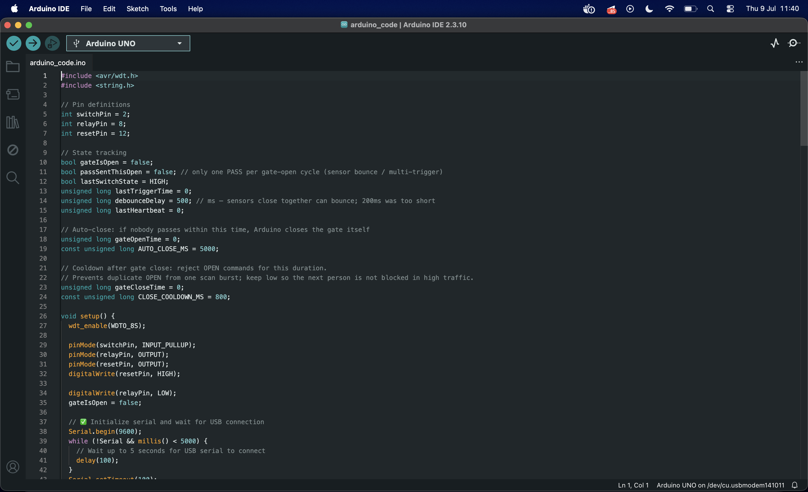
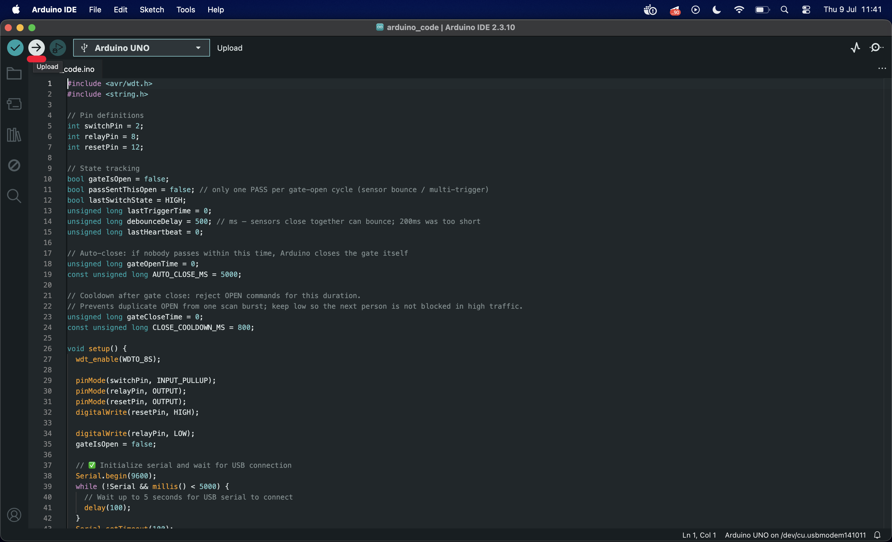
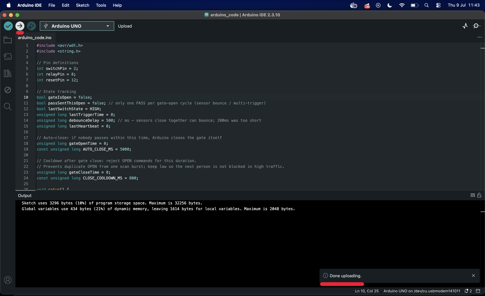

# Ice City — Turnstile Mini PC Setup

Step-by-step guide to set up the mini PC that runs the Ice City turnstile (turniket).

## 1. Install the OS
Install **Xubuntu 22.04 (Jammy)** on the mini PC.

- Video tutorial: https://youtu.be/suYEf1ERnP4?si=ra14UM0DLsXk9Ain
- Download (ISO): https://cdimage.ubuntu.com/xubuntu/releases/jammy/release/xubuntu-22.04.5-desktop-amd64.iso
- All releases: https://cdimage.ubuntu.com/xubuntu/releases/jammy/release/

## 2. Configure a static IP
Connect the mini PC to the turnstile network and give it a **free, unused IP** on the `192.168.7.0/24` subnet:

```
Gateway: 192.168.7.10
Mask:    24
Internet: 8.8.8.8
```

## 3. Reboot
Reboot the mini PC so the static IP takes effect.

## 4. Run the setup
Open a terminal (**Ctrl + Alt + T**), paste the block below (**Ctrl + Shift + V**) and press **Enter**:

```bash
sudo apt update && sudo apt install -y git && \
(git clone https://github.com/abdulazizax/ice-city-minipc-init.git ~/icecity/ice-city-minipc-init || git -C ~/icecity/ice-city-minipc-init pull) && \
cd ~/icecity/ice-city-minipc-init && sudo ./setup.sh && sudo reboot
```

When it asks for the password, type it and press **Enter** (the password is not shown while typing).

This takes several minutes. At the end the mini PC restarts by itself.

## 5. Done
After the restart the turnstile starts automatically.

## Find the MAC address
Open a terminal (**Ctrl + Alt + T**), paste the command below and press **Enter**:

```bash
printf '%-16s %-19s %-6s %s\n' PORT MAC STATUS IP
for i in /sys/class/net/*; do
  [ -e "$i/device" ] && [ ! -d "$i/wireless" ] || continue
  n=$(basename "$i")
  printf '%-16s %-19s %-6s %s\n' "$n" "$(cat "$i/address")" "$(cat "$i/operstate")" "$(ip -4 -br addr show "$n" | awk '{print $3}')"
done
```

It prints every Ethernet port of the mini PC, for example:

```
PORT             MAC                 STATUS IP
enp1s0           a1:b2:c3:d4:e5:f6   up     192.168.7.55/24
enp2s0           a1:b2:c3:d4:e5:f7   up     192.168.1.20/24
enp3s0           a1:b2:c3:d4:e5:f8   down
```

`up` means a cable is plugged into that port.

---

## Arduino setup

The turnstile gate is controlled by an Arduino running [`arduino_code/arduino_code.ino`](arduino_code/arduino_code.ino).

### Uploading the sketch

1. Install the [Arduino IDE](https://www.arduino.cc/en/software) and open `arduino_code/arduino_code.ino`.
2. Connect the Arduino to your laptop with a USB cable.
3. Go to **Tools → Board** and select your Arduino model. Then go to **Tools → Port** and select the port the Arduino is connected to (shown at the bottom of the window).

   

4. Click the **Upload** (→) button.

   

5. Wait until you see **"Done uploading"**.

   

### Wiring

**Relay:**
1. Relay `IN` → Arduino pin `8`
2. Relay `GND` → Arduino power `GND`
3. Relay `VCC` → Arduino power `5V`

**USB-TTL:**
1. USB-TTL `GND` → Arduino power `GND`
2. USB-TTL `RXD` → Arduino `TX`
3. USB-TTL `TXD` → Arduino `RX`
4. USB-TTL `5V` → Arduino analog in `Vin`

Now connect the Arduino to the mini PC with a USB cable — it will be detected automatically.
